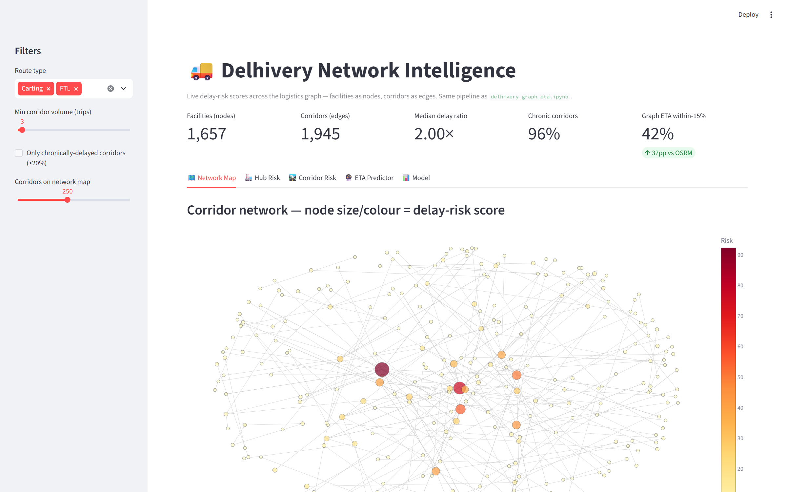
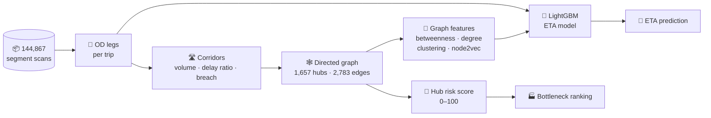
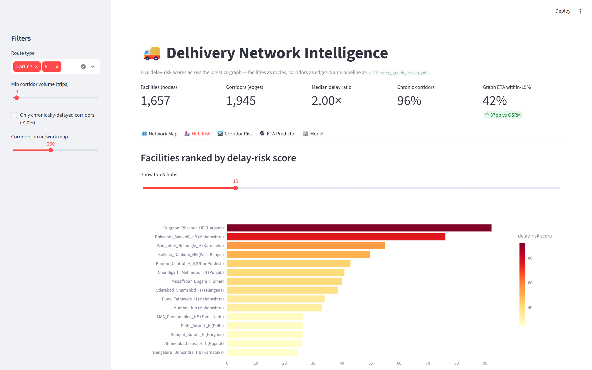
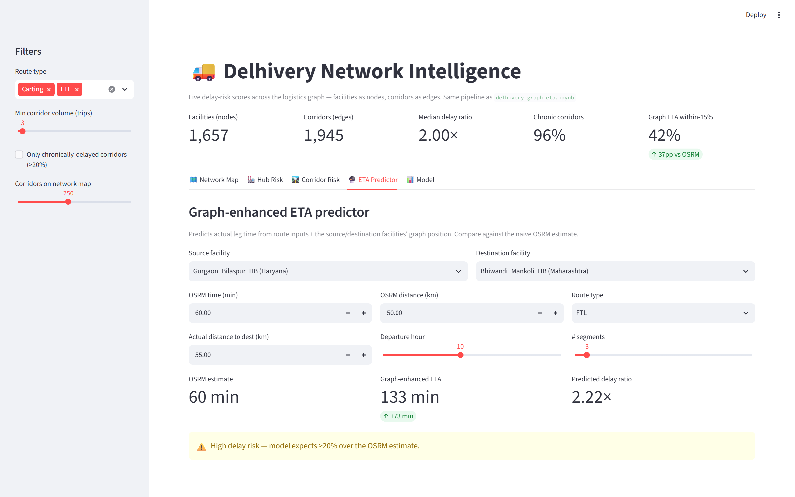
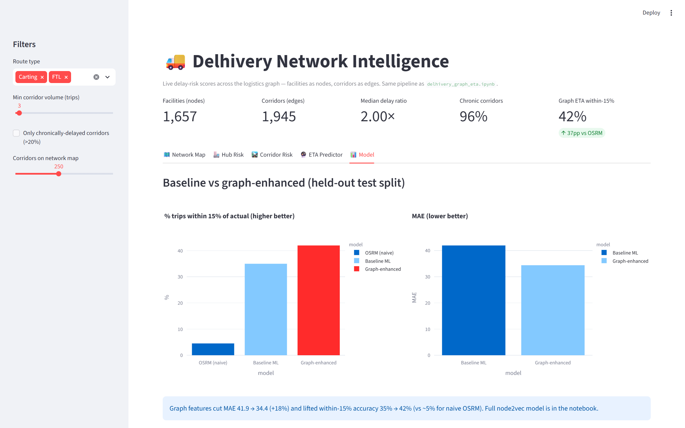

<div align="center">

# 🚚 Delivery Network Intelligence

### Graph-based ETA prediction & bottleneck detection for a national logistics network

**Treat the network as a graph, not a list of routes: ETAs land within 15% of reality ~10x more often than the routing engine.**

[](https://delivery-network-intelligence-bgrkkktakv7jqgvm7msawv.streamlit.app/)
[](strategy_memo.md)
[](delhivery_graph_eta.ipynb)


</div>

<p align="center">
  
  <br><sub><i>Network Map: 1,657 facilities as nodes; the biggest, darkest nodes are the hubs driving network-wide delay.</i></sub>
</p>

---

## ⚡ TL;DR

| | |
|---|---|
| 🐢 **The problem** | The routing engine (OSRM) underestimates leg time by **~2x**. Only **~5%** of its ETAs land within 15% of actual. |
| 🕸️ **The approach** | Model **1,657 facilities** and **2,783 corridors** as a directed graph. Feed each hub's structural role (centrality, degree, clustering, node2vec embeddings) into a LightGBM ETA model. |
| 🎯 **The result** | **~46%** of legs predicted within 15% of actual, MAE down from **107 → 32 minutes**, measured on a **future week the model never saw**. |
| 🏭 **The action** | The **top 3 bottleneck hubs** account for ~7% of all network SLA breach. Fixing them is worth a **~4% cut in network-wide late time**. |

---

## 🐢 The problem

OSRM assumes clean roads and shortest paths. Real operations don't work that way: across **14,817 trips**, the typical leg takes about **2x longer than OSRM predicts**, and **~96% of corridors** run more than 20% slower than promised.

That breaks SLAs, erodes customer trust, and undermines every capacity and staffing plan built on those estimates. Treating each leg as an isolated route misses the real cause: **delay propagates through hubs**. A congested, highly central facility slows everything that passes through it.

---

## 📊 Results

Evaluated on a **time-based holdout**: trained on trips from **Sep 12–26, 2018** and tested on **Sep 27 – Oct 3, 2018**. No trip appears in both splits.

| ETA method | Within 15% of actual | MAE (minutes) |
|---|:---:|:---:|
| OSRM (naive routing) | ~5% of legs | 107 |
| ML baseline (no graph features) | ~35% of legs | 42 |
| **Graph-enhanced model** | **~46% of legs** | **32** |

```
Within 15% of actual
OSRM            █▌                          ~5%
ML baseline     ██████████▌                 ~35%
Graph-enhanced  █████████████▊              ~46%   ← ~10x OSRM
```

- **Graph features alone** cut MAE by **~24%** and add **~11 percentage points** of accurate legs over the same model without them.
- **No leakage:** the graph used for model features is built from **training legs only**. Facilities seen only in the test week get zero-valued graph features.

---

## 🏭 Top bottleneck hubs

Facilities ranked by **SLA-breach contribution**, meaning the late time each one generates (volume × how badly its corridors overshoot).

| # | Hub | Why it matters | Recommended fix |
|:-:|---|---|---|
| 1 | **Bhiwandi_Mankoli_HB** (MH) | Highest realized late time in the network | Sortation/dock capacity to cut dwell |
| 2 | **Gurgaon_Bilaspur_HB** (HR) | Highest betweenness, so delays ripple network-wide | Parallel corridor / load balancing |
| 3 | **Kolkata_Dankuni_HB** (WB) | Major eastern chokepoint, chronic overshoot | Capacity + peak-hour volume shift |
| 4 | **Kanpur_Central_H** (UP) | High-volume northern transfer point | Monitor |
| 5 | **Bangalore_Nelamangala_H** (KA) | Central southern hub, high betweenness and degree | Monitor |

💰 Removing ~60% of excess delay at the top 3 hubs alone cuts **~4% of network-wide late delivery time**. Full reasoning, assumptions and the FTL-vs-Carting pilot recommendation are in the **[strategy memo](strategy_memo.md)**.

---

## 🧠 How it works



1. **Segments → legs.** Raw segment-level scans are aggregated into origin–destination (OD) legs per trip. Cumulative fields take the final value and per-segment fields are summed.
2. **Legs → corridors.** Legs are grouped by `source → destination` with trip volume, median delay ratio (`actual / OSRM`), and an SLA-breach score of `trips × max(median_delay_ratio − 1, 0)`.
3. **Corridors → graph.** A directed graph is built with corridors as edges, weighted by delay ratio.
4. **Structural features.** Betweenness centrality, in/out degree and clustering coefficient are computed per facility, plus node2vec embeddings in the notebook.
5. **Risk scoring.** Each hub gets a 0–100 score: **70% realized breach + 30% betweenness centrality**. The weighting leans on observed delay and keeps a structural term so that central hubs, where a slowdown would spread furthest, are flagged even before they show up in breach volume. It's a tunable heuristic, not a fitted parameter.
6. **ETA model.** LightGBM is trained twice, once on base route features and once with graph features added, to isolate the lift that comes from network structure.

---

## 🖥️ Interactive dashboard

**[▶ Open the live app](https://delivery-network-intelligence-bgrkkktakv7jqgvm7msawv.streamlit.app/)**

> ⏳ It's hosted on Streamlit Community Cloud's free tier, which sleeps when idle. The first load may take 30–60 seconds.

| Tab | What you can do |
|---|---|
| 🗺️ **Network Map** | Explore the corridor graph. Node size and color show delay-risk score. |
| 🏭 **Hub Risk** | Rank facilities by risk and drill into any hub's corridors. |
| 🛣️ **Corridor Risk** | Find the corridors contributing the most SLA breach. |
| 🔮 **ETA Predictor** | Pick a source and destination, get a predicted leg time, and compare it with OSRM. |
| 📊 **Model** | Compare the baseline and graph-enhanced models on held-out data. |

<table>
  <tr>
    <td width="50%"><p align="center"><b>🏭 Hub Risk</b></p></td>
    <td width="50%"><p align="center"><b>🔮 ETA Predictor</b></p></td>
  </tr>
  <tr>
    <td colspan="2"><p align="center"><b>📊 Model comparison</b> (dashboard variant without node2vec)</p></td>
  </tr>
</table>

---

## 🚀 Getting started

**Requirements:** Python **3.10–3.12** (tested on 3.10). Python 3.13+ isn't supported because `numpy<2.0` has no wheels for it.

```bash
git clone https://github.com/lokifergusion9/delivery-network-intelligence.git
cd delivery-network-intelligence

python -m venv .venv                # Windows with several Pythons: py -3.10 -m venv .venv
source .venv/bin/activate           # Windows: .venv\Scripts\activate
pip install -r requirements.txt
```

```bash
jupyter notebook delhivery_graph_eta.ipynb   # full analysis
streamlit run app.py                         # dashboard
```

---

## 📁 Repository structure

```
delivery-network-intelligence/
├── delhivery_graph_eta.ipynb   # Full analysis: prep → graph → risk → node2vec → models → impact
├── app.py                      # Streamlit dashboard (same pipeline as the notebook)
├── strategy_memo.md            # 2-page business memo for network operations leadership
├── delivery_data.csv           # Raw segment-level shipment data (~55 MB)
├── docs/                       # Dashboard screenshots used in this README
└── requirements.txt
```

---

## 📦 Data

The public **[Delhivery logistics dataset](https://www.kaggle.com/datasets/nayanack/delhivery)** (Kaggle) contains 144,867 segment-level scan records covering 14,817 trips between 1,657 facilities across India in Sep–Oct 2018. It ships with a `data` column marking a chronological training/test split, which this project uses as is. Times are in minutes. The dataset is released under **CC0: Public Domain**.

---

## 📝 Notes & limitations

- **Notebook vs. dashboard:** the notebook's best model includes node2vec embeddings (~46% within 15%). `app.py` drops them for fast, cache-friendly predictions, so its headline accuracy is a little lower (~42%).
- **Cold-start hubs:** facilities that never appear in training get zero graph features, so predictions for brand-new hubs fall back toward the base model.
- **Impact figures** in the memo use explicit, adjustable assumptions (e.g. 60% delay removal), documented in the notebook.
- **Large file:** `delivery_data.csv` is ~55 MB and is tracked directly in git. To stop versioning it, uncomment the line in `.gitignore`.

---

## 🔭 Future work

- Temporal graphs: hub congestion by hour of day and day of week
- Graph neural networks (GraphSAGE / GAT) in place of hand-crafted centrality and node2vec
- Prediction intervals (quantile LightGBM) so planners get ETA ranges, not just point estimates
- Live re-scoring of hub risk as new scans arrive

---

<div align="center">

**Lokesh Kumar** 

[](https://github.com/lokifergusion9)

⭐ If you found this useful, consider starring the repo!

</div>
